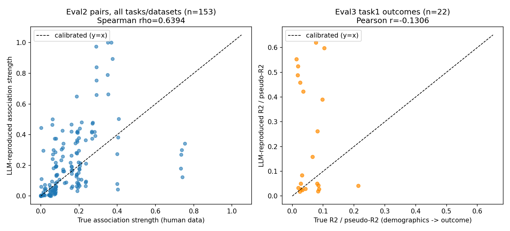
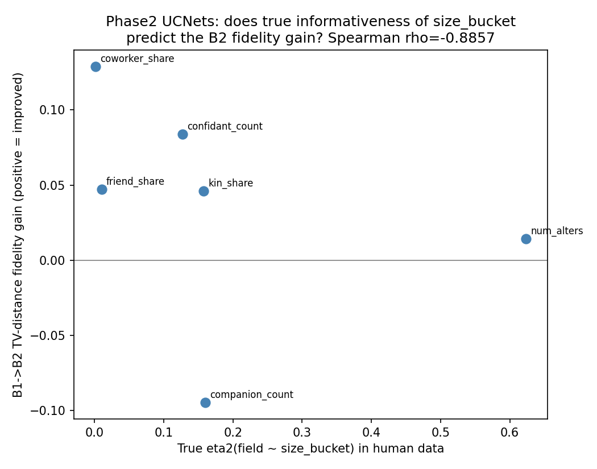
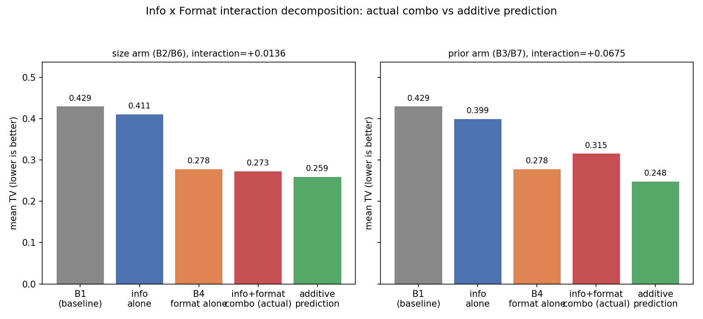

# LLM 网络生成中的 Predictor 与 Sampler 诊断实验

模型：`llama3.1:latest`
数据：UCNets Wave 1（N=1156 gold）
关联脚本：`../cross_phase_analysis/analysis_a_info_sufficiency.py`、`analysis_b5_bucket_conditional.py`、`analysis_c_info_format_interaction.py`
关联生成与评估：`Testing/scripts/run_network_generation.py`、`evaluate_network.py`

> **2026-08-20 重评估摘要。** 评估统一过滤 `schema_ok`，跨臂采用共同样本。N0 composition mean TV=0.5092（N=1094），core=0.2688；N0–N3 共同 N=846。T1=153 pairs，Pearson 0.4478、Spearman 0.6394、overshoot 55.6%；Eval3=22 outcomes，r=-0.1306（p=0.562）。T2 六字段 rho=-0.8857 仅探索性。T5 size/prior 共同 N=307/289，interaction=0.0092/0.1223，只解释工程可组合性。

---

## 1. 问题重述

State 与 Network 阶段最初的叙事是在寻找一种更好的 recovery 方法，即通过不同的 prompt 条件（更多信息、不同格式、不同指令）让 LLM 生成的个体状态或网络更接近人类真值。这个叙事有一个隐含假设：LLM 是一个校准的采样器（sampler），只要给它正确的信息，它就会从正确的条件分布中抽样，我们要做的是找到让它抽样更准的配方。

到目前为止的所有实验结果都不支持这个假设。更贴切的描述是：LLM 更像一个 predictor，也就是一个在给定输入下检索最像样、最典型的一种叙事模式的生成器，而不是在给定条件下从真实条件分布中抽样的生成器。

本文档补充四组新的证据，把这个判断从直觉变成可检验、可复现的诊断结果，并重新定位后续实验设计的方向：不再问哪种配方能把 LLM 修好，而是系统地刻画它在哪些维度上表现出 predictor 特征，在哪些维度上表现出部分 sampler 特征，以及这两种特征如何随信息类型、生成格式而变化。

---

## 2. 证据一：关联强度的校准检验

如果 LLM 是校准的采样器，它复现出的两变量关联强度应该和人类数据中的真实关联强度大致相等，落在 45 度线附近。如果 LLM 是 predictor，它更可能对某些话题给出一个偏高且相对固定的关联强度，而不太在意这两个变量在真实数据里到底有多相关。

使用 State 阶段已有的 eval2（关联保真度）和 eval3（预测强度保真度）产出，不需要任何新生成。

### 2.1 Eval2：跨数据集、跨任务的两两关联强度

汇总 GSS 1987、GSS 2010、UCNets W1 三个数据集，task1/1b/2/2b/3 五种 prompt 条件，共 153 对变量关联。

| 指标 | 数值 |
|---|---:|
| 真实关联强度均值 | 0.159 |
| LLM 复现关联强度均值 | 0.211 |
| LLM 超过真实值的比例 | 55.6% |
| Pearson r(真实, LLM) | 0.4478 |
| Spearman rho(真实, LLM) | 0.6394 |

分任务看，task3（politics/religion 条件化）反而是校准最好的一组（Spearman 0.82，且平均没有系统性夸大，inflation=-0.006），task1（无条件基线）和 task1b（反类型学基线）夸大最明显（inflation 分别为 0.102 和 0.082）。这说明关联强度的夸大不是一个固定不变的常数偏差，而是随任务条件变化的，其中反类型学指令和政治宗教条件化对压低虚假关联有一定效果，但都没有把 LLM 变成真正校准的采样器（哪怕最好的 task3，Spearman 也只有 0.82，且仍有 30% 的样本对是 LLM 超过真实值）。

### 2.2 Eval3：人口学锚点对结果变量的预测强度

同样使用已有数据，看 5 个基础人口学变量（age_group, sex/gender, degree/education, marital_status, race_ethnicity 等）对每个结果变量的 R2 / pseudo-R2。

| 指标 | 数值 |
|---|---:|
| 结果变量数 | 22 |
| 真实 R2 范围 | 0.013 到 0.213（普遍很弱） |
| LLM 复现 R2 范围 | 0.0183 到 0.6198（跨度巨大） |
| Pearson r(真实, LLM) | **-0.1306**（p=0.562，不显著） |

这是最干净的一条证据：真实数据里，人口学变量对幸福感、健康自评、信任等主观态度的解释力都很弱（R2 普遍在 0.01 到 0.1 之间），但 LLM 生成结果中，同样这批变量对某些结果（happiness, self_rated_health, trust, people_are_helpful）表现出 0.4 到 0.6 的伪 R2，即好像人口学几乎决定了这个人的主观感受，同时对另一些结果（political_ideology, religious_service_attendance）复现出接近真实的低 R2。

夸大幅度最大的五个结果变量：

| 数据集 | 结果变量 | 真实 R2 | LLM R2 | 夸大幅度 |
|---|---|---:|---:|---:|
| gss_1987 | general_happiness | 0.013 | 0.552 | +0.539 |
| gss_2010_network | people_are_helpful | 0.076 | 0.571 | +0.495 |
| gss_1987 | self_rated_health | 0.019 | 0.513 | +0.494 |
| gss_2010_network | people_can_be_trusted | 0.103 | 0.595 | +0.492 |
| gss_2010_network | general_happiness | 0.018 | 0.456 | +0.438 |

Pearson r 为负这一点很关键：LLM 制造的虚假确定性程度，和这个变量真实可被人口学解释的程度，完全不成正比，甚至方向相反。这不是一个信号强度校准问题（校准误差应该表现为正相关但斜率偏离1），而是一个话题特定的刻板印象问题：某些结果变量（幸福、健康、信任）天然容易被 LLM 训练语料中的刻板叙事（比如年龄大等于不健康、教育低等于不信任人）绑定，而政治立场、宗教这类话题可能因为对齐训练中的中立化处理反而被保护了起来，没有被绑定出虚假的人口学决定论。

---

## 3. 证据二：条件相关性与保真度提升的错配

如果 LLM 是采样器，给它一个真正有信息量的条件变量应该带来更大的保真度提升，给它一个几乎无关的条件变量应该带来接近零的提升。用 UCNets 的 gold 数据和已有的 N0、N1、N2 评估结果验证这一点，同样不需要新生成。

对 N0 到 N1（引入 true size_bucket 作为条件）涉及的 6 个组成字段，先在人类数据里计算每个字段真正被 size_bucket 解释的方差比例（eta2），再对比 N0 到 N1 的 TV 距离改善幅度。

| 字段 | eta2(字段~size_bucket) | N0→N1 的 TV 提升 |
|---|---:|---:|
| num_alters | 0.623（size_bucket 本身就是从它分箱来的，理论上信息量最大） | 0.017（提升几乎最小） |
| kin_share | 0.157 | 0.050 |
| confidant_count | 0.127 | 0.085 |
| companion_count | 0.160 | -0.097（反而变差） |
| friend_share | 0.010 | 0.042 |
| coworker_share | 0.001（几乎无关） | 0.153（提升最大） |

六字段 paired Spearman rho(eta2, TV提升) = **-0.8857**。这是只有 6 个字段的探索性点估计，不能作为正式七字段冲突或显著负相关来表述；历史七字段结果仅作敏感性说明。

---

## 4. 证据三：显式同质性条件化实验（N4）

前三组证据都是复用已有数据的事后分析，这一组是新设计并跑完的实验，直接测试 State、Network、T4 三轮实验里反复出现、且从未被修复的种族同质性缺口（human 约 0.97，LLM 稳定在 0.58 到 0.60 附近）。

### 4.1 实验设计

新增任务 N4：在 N0（oneshot，无格式无信息干预）基础上，额外把每个人真实的全网同种族占比分箱（same_race_share_bucket，取值 low / medium / high）作为已知条件放进 prompt，明确指示模型生成的 5 个核心关系人中同种族比例应当与这个 bucket 一致。这是信息干预中信息量最直接、最明确的一种，因为它就是在直接告诉模型答案的分布区间。

真实数据里这三个 bucket 的分布本身就很不均衡（这一点也是本轮新发现）：

| bucket | 定义 | 占比 |
|---|---|---:|
| low | 同种族占比 < 0.75 | 5.7% |
| medium | 0.75 到 0.99 | 3.7% |
| high | = 1.0（网络完全同种族） | 90.6% |

### 4.2 结果：条件被完全忽略

全量生成 N=1156，schema_ok=1099。按给定的 bucket 分组，比较人类真实同种族率和 LLM 生成的同种族率：

| bucket | n | 真实同种族率 | LLM 同种族率 | 差距 |
|---|---:|---:|---:|---:|
| low | 62 | 0.488 | 0.555 | +0.066 |
| medium | 39 | 0.876 | 0.564 | -0.312 |
| high | 998 | 1.000 | 0.568 | -0.432 |

LLM 的输出在三个 bucket 之间几乎不变，稳定在 0.555 到 0.568 之间（跨度仅 0.013），而真实值从 0.488 跨越到 1.000。也就是说无论告诉模型这个人的网络是低同质性还是完全同质性，它都会生成一个大致固定比例（约 55% 到 57%）的同种族核心关系人，即它内部有一个关于合理核心五人小组种族构成的默认模板，这个模板几乎不受显式指令影响。

整体上看，N4 相对 N0 没有带来任何净改善：

| 指标 | N0 | N4 |
|---|---:|---:|
| composition mean TV（各臂自身 `schema_ok`） | 0.5092 | 0.5025 |
| same_race 差距（LLM-human） | -0.383 | -0.401 |

UCNets 这一臂的条件是 full-network bucket，输出靶量却是 core roster，estimand 不一致且分箱退化，因此只作探索性示例；T3 主结论应以 GSS/NSHAP 的非退化、靶量对齐实验为准。

---

## 5. 证据四：信息与格式的交互实验（N5、N6）

Network 阶段的原始设计把信息干预（N1 size_bucket、N2 population priors）和格式干预（N3 roster 多步生成）当作两个独立变量分别测试，但从未测试过组合使用时是否可以叠加。这一组新实验直接检验这一点。

### 5.1 实验设计

新增 N5（= N1 的信息条件 + N3 的多步流程）和 N6（= N2 的信息条件 + N3 的多步流程），各在固定的 400 人子样本上生成（子样本用固定种子抽取，N0、N1、N2、N3 也在同一子样本上重新评估，保证四臂比较严格配对，不受样本漂移影响）。如果两个杠杆的效果是可加的，N5 相对 N0 的提升应约等于 N1 的提升加上 N3 的提升，N6 同理。

### 5.2 结果：工程可组合性依赖干预类型

以 mean TV 距离为例（越低越好）：

| | N0（基线） | 信息单独 | N3（格式单独） | 信息+格式组合 | 可加性预测 | 实际 vs 预测 |
|---|---:|---:|---:|---:|---:|---:|
| size 臂（共同 N=307） | 0.5176 | 0.4893 | 0.2999 | 0.2808 | 0.2716 | interaction 0.0092 |
| prior 臂（共同 N=289） | 0.5187 | 0.4579 | 0.3131 | 0.3746 | 0.2523 | interaction 0.1223 |

最新共同样本上，size 臂 interaction=0.0092，接近可加预测；prior 臂 interaction=0.1223，组合依赖更强。这里描述的是工程可组合性，不把交互项解释为 sampler 的必要判据。

一个具体的机制线索来自 num_alters 均值：

| | N0 | 信息单独 | N3 | 组合 | 可加性预测 |
|---|---:|---:|---:|---:|---:|
| size 臂 | 12.18 | **17.01**（非常接近真实均值 17.57） | 12.54 | 12.97 | 17.36 |
| prior 臂 | 12.18 | **16.79**（同样接近真实均值） | 12.54 | 13.27 | 17.15 |

单独给信息条件时（N1、N2 的 oneshot 格式），模型能把网络规模的均值几乎精确校正到真实水平。但一旦把同样的信息条件塞进 5 步 roster 流程里，这个校正基本消失，组合结果又掉回到接近未条件化时的 12 到 13 附近。这说明多步流程本身携带一个很强的默认轨迹（大概率是因为每一步都在逐个列举具体的人，模型倾向于列举一个中等规模、容易叙述完整的名单），这个格式自带的默认值会压制住显式数值信息本应带来的修正，而不是被信息覆盖或和信息共同作用。

同种族率在两个组合臂里都比 N3 单独略高（size 臂 0.627 到 0.639，prior 臂 0.627 到 0.668），但这两个信息条件都不携带任何种族信息，这个变化更可能是引入额外条件文本后网络整体变得更稠密、角色更重复导致的副产品，而不是真正的种族层面修复，和 N4 的结论互相印证：种族同质性缺口对目前尝试过的所有信息类干预都不敏感。

---

## 6. 综合结论

把四组证据放在一起看，可以给 predictor 假说列出一张具体、可验证的证据清单：

1. LLM 复现的关联强度和真实关联强度只有中等程度的等级相关（Spearman 0.63），且系统性偏高，偏高程度因任务条件、话题而异，不是一个统一的信号放大系数。
2. LLM 制造的虚假决定论程度和这个结果变量真正被人口学解释的程度不相关甚至负相关，说明夸大是话题特定的刻板印象检索，不是信号强度的误校准。
3. 给模型一个条件变量后，保真度提升集中在与该条件真实关系最弱的字段上，而不是最强的字段上，说明提升更像是一次性、非选择性的全局调整。
4. 把答案的分布区间直接写进 prompt（N4），模型的输出完全不随这个区间变化，说明它并不是在按给定条件抽样，而是在检索一个固定的典型样式。
5. N5/N6 显示工程可组合性依赖信息类型（interaction 0.0092/0.1223）；这对干预设计有用，但不是 sampler/predictor 的必要识别条件。

这些结果表明已测试组合的工程效果依赖具体干预，但不能推出所有可能配方都不存在。现有结果支持条件采样尚未校准，也与默认模板式生成相容；由于缺少重复生成与更强机制对照，不把偏差唯一归因为 predictor。

---

## 7. 对研究设计和叙事方式的建议

基于以上结果，建议把整个 Sub-Experiment B 的叙事从寻找更优的 recovery 方法，调整为系统刻画 predictor 行为的边界，具体体现在三个层面：

第一，把每一个干预都明确标注它属于信息类、格式类还是指令类，并且对每一类干预都同时报告它在真正相关的维度上的效果和在不相关维度上的效果，用两者的差异去衡量这个干预是选择性生效还是全局性生效。目前的报告习惯是只看整体 TV、entropy ratio 这类汇总指标，容易把一次全局性的、非选择性的调整误读成一次有效的信息利用。

第二，把交互效应作为一等研究问题，而不是把每个干预单独测完就结束。N5、N6 的结果说明干预之间的组合方式本身携带信息，简单的独立测试加事后猜测可加性是不够的，需要为关键的干预组合专门设计配对实验。

第三，把 predictor 和 sampler 的区分作为贯穿 State、Network、T4 三轮实验的统一诊断框架来重新组织现有的写作，而不是分别叙述三轮实验各自的发现。State 阶段的过度关联（Eval2、Eval3）、Network 阶段的同质性缺口和条件不敏感（N0 到 N4）、T4 里换真实 State 也无法降低网络误差，这三个发现在 predictor 框架下是同一件事的三个侧面：模型在每个阶段都优先检索一个内部典型样式，只在有限程度上受输入条件调制，且这个调制程度和真正的信息价值不成正比。

---

## 附录：产出文件清单

| 文件 | 内容 |
|---|---|
| `../cross_phase_analysis/analysis_a_info_sufficiency.py` | 证据一、二的计算脚本 |
| `../cross_phase_analysis/analysis_a_results.json` | 证据一、二的完整数值结果 |
| `../cross_phase_analysis/fig_eval2_human_vs_llm_association.png` | 证据一图 |
| `../cross_phase_analysis/fig_phase2_info_sufficiency.png` | 证据二图 |
| `../cross_phase_analysis/analysis_b5_bucket_conditional.py` | 证据三的计算脚本 |
| `../cross_phase_analysis/b5_bucket_conditional_results.json` | 证据三的完整数值结果 |
| `../cross_phase_analysis/analysis_c_info_format_interaction.py` | 证据四的计算脚本 |
| `../cross_phase_analysis/analysis_c_results.json` | 证据四的完整数值结果（含全部10个指标，不止 mean TV） |
| `../cross_phase_analysis/fig_info_format_interaction.png` | 证据四图 |
| `Testing/configs/network/ucnets_w1.yaml` | 新增 N4/N5/N6 任务定义 |
| `Testing/scripts/clean_network_ucnets.py` | 新增 same_race_share 全网同质性字段 |
| `Testing/scripts/build_network_inputs.py` | 新增 N4/N5/N6 的 prompt 构建与子样本抽取逻辑 |
| `Testing/scripts/run_network_generation.py` | 多步流程新增 size_bucket / population_priors 条件注入 |
| `Testing/scripts/evaluate_network.py` | 新增 N4/N5/N6 评估、同质性聚焦表、配对子样本比较表 |
| `Testing/scripts/launch_n4n5n6.sh` | N4/N5/N6 三 GPU 并行启动脚本 |
| `Testing/T1_association/ucnets_w1/eval/phase2_eval_summary.json` | 完整评估结果（含 N0 到 N6、subset_400 配对表） |
